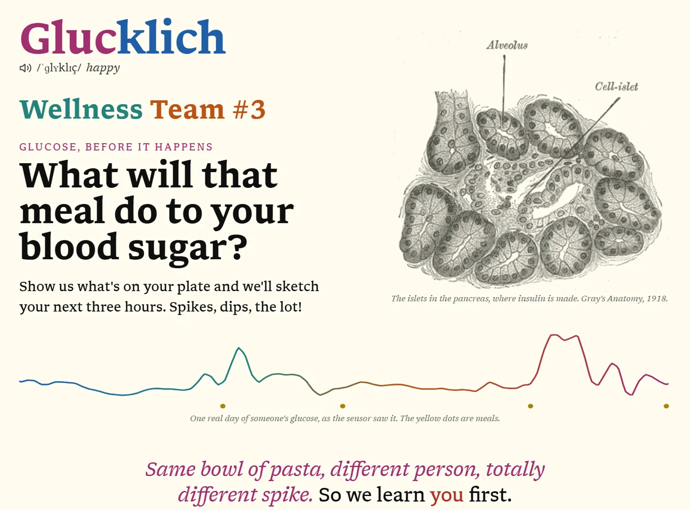
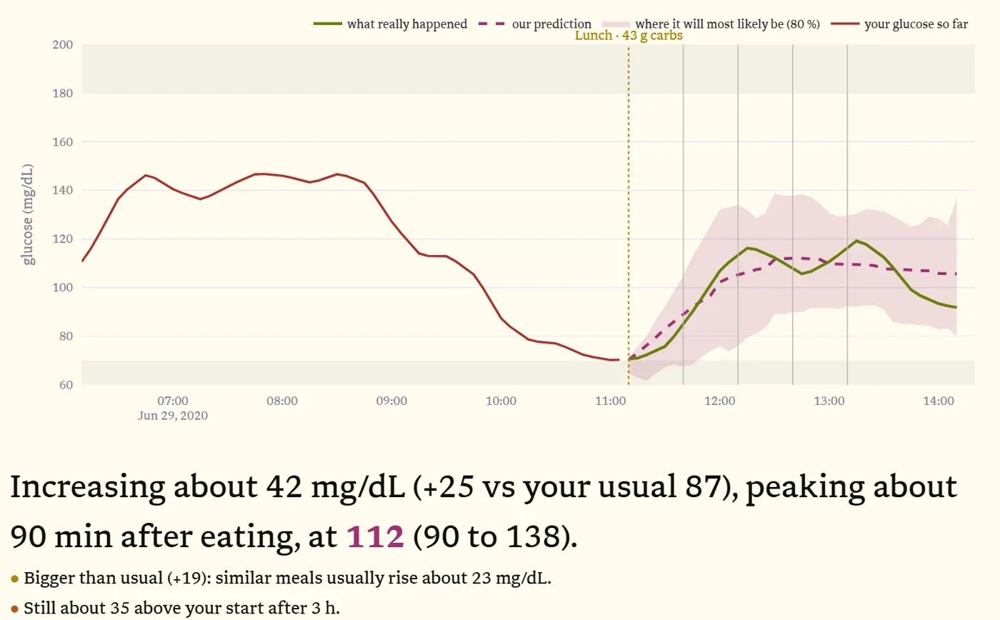
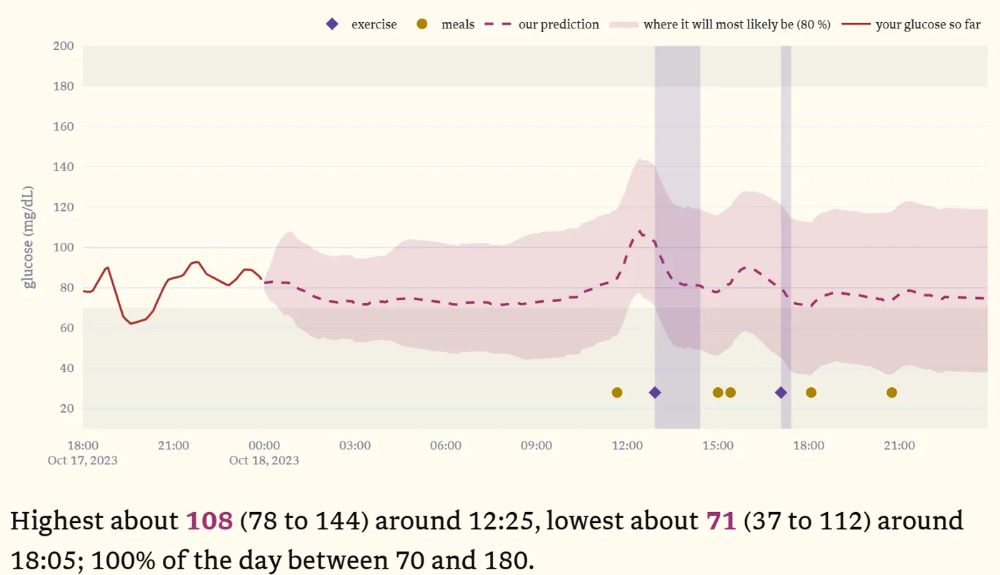
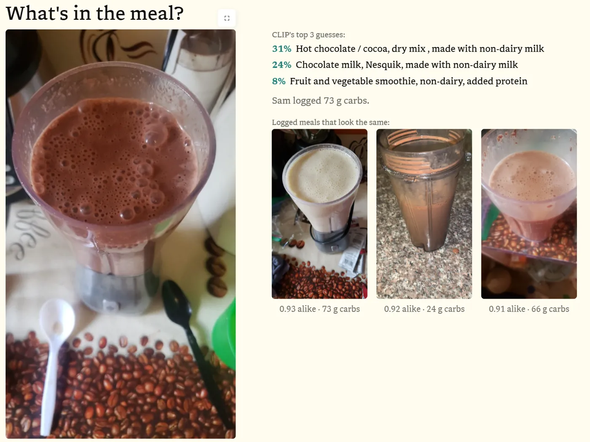
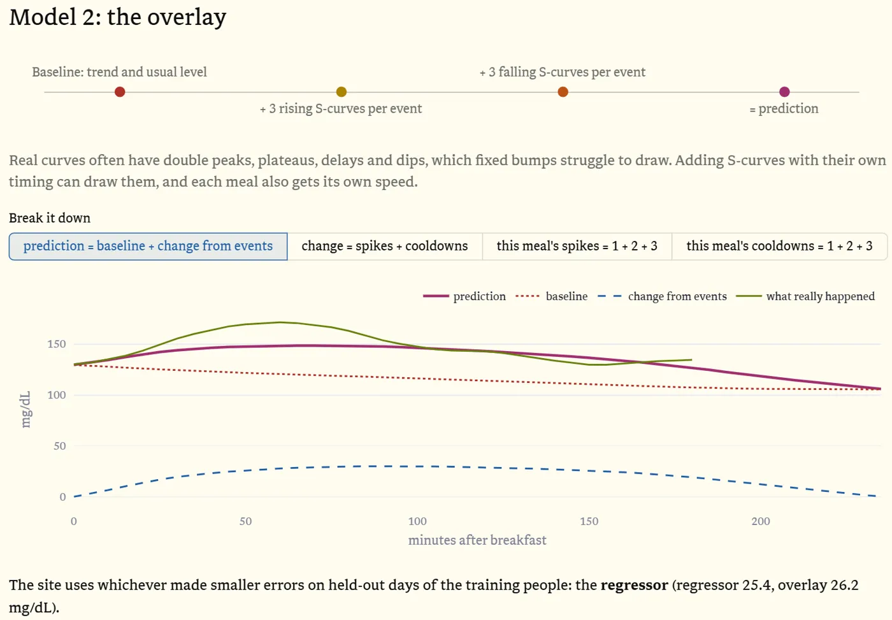
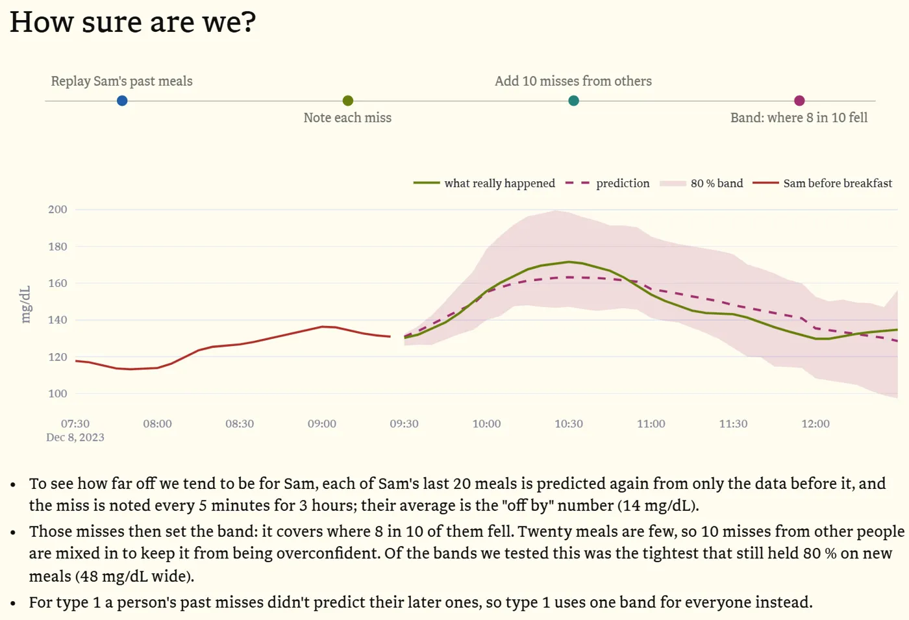

# Glucklich

*Glücklich* is German for *happy*. Built by **Wellness Team #3** for Health Hack 2026 (Wellness Reimagined,
Challenge 3: Predict My Glucose).

**Try it on the web: https://almostaphysicist.github.io/HealthHack2026/app/**
(the whole site runs in your browser; give it a minute or two to load the first time)

Project page: https://almostaphysicist.github.io/HealthHack2026/



## What is this?

What will that meal do to your blood sugar? Show us what's on your plate and we'll sketch your next three hours.
Spikes, dips, the lot!

Same bowl of pasta, different person, totally different spike. So we learn *you* first: your own week of glucose,
meals and activity (and insulin, if you take it), and only borrow from people like you where your data runs thin.
And we're honest about how sure we are: every prediction comes with a band where about 8 in 10 of your real
readings land.



## What you can do

- **Meal:** drop your glucose history and tell us what you're eating: snap a photo, search the food, or set the
  numbers yourself. You get the next 3 hours, plus a couple of notes like "bigger than usual".
- **Full Day:** plan your meals, exercise and insulin and see the whole day: the highs, the lows and when they happen.
- **Tell us how we did:** drop what really happened (a file, a whole folder, a zip, whatever). We find the readings
  for that window, score ourselves, and learn from it for next time.
- **Log:** no files? Make them here in a table.
- **How it works:** the whole thing, step by step, on one real person. Start here if you want the details.



## How it works

The **How it works** page in the app walks through all of this on Sam (type 2), with his own data and charts.
The short version:

1. **Getting to know you.** A glucose sensor reads every 5 minutes. Add meals, activity and, for type 1, insulin.
2. **Cleaning and classification.** We smooth out the sensor's tiny wiggles, then a small classifier works out if
   you're type 1 or not from your glucose alone, which picks the model.
3. **What's in the meal?** CLIP (an open image model) gives a phrase for the photo. Its 3 best guesses get looked up
   in the USDA food database at a typical portion, and matched against meals you logged before that look the same.

   

4. **Food and insulin in the blood.** Each meal turns into absorption curves (slower with fat, protein and fiber).
   Insulin follows the OpenAPS curve: real doses for type 1, carbs as a stand-in for everyone else.
5. **The model.** A time series regression: each input's curve times its weight, all added up, gives your glucose 5 to
   240 min ahead. The weights start from everyone's, then people like you, and move toward yours as far as your data
   backs it up. We also built a second model out of S-curves for every rise and fall, and the site uses whichever did
   better.

   

6. **How sure are we?** We replay your last 20 meals from only what came before each one, note how far off we were,
   mix in 10 misses from other people, and draw the band where 8 in 10 fell.

   

7. **Validation.** The test people are never seen in training: learn days 1 to 7, predict every meal after,
   compare with the raw sensor. The site plays by the same rule.

## How well does it do?

On people the model never saw:

| | Typical miss (RMSE, mg/dL) | Truth inside the 80 % band |
|---|---:|---:|
| Healthy, prediabetes, type 2 | 22.4 | about 80 % |
| Type 1 | 41.6 | about 82 % |

Type 1 is harder: logged carbs are rough, and insulin pumps keep reacting to glucose as it changes.

## Run it yourself

The web version needs nothing installed. To run it locally (faster, and it reads food photos):

```
git lfs install
git clone https://github.com/AlmostAPhysicist/HealthHack2026
cd HealthHack2026
pip install -r requirements.txt
streamlit run app.py
```

The trained weights come with the code. The first photo you read downloads CLIP (about 1.7 GB, once). Retraining
needs the datasets themselves (see `AboutDatasets.md`), which aren't in this repo.

To deploy your own copy: fork it and turn on GitHub Pages. The GitHub Action builds the in-browser site.

## Code

```
app.py                  the site: top navigation over the pages in views/
views/
  home.py               landing page and the three-person demo
  meal.py, full_day.py  predict a meal / a whole day, then validate
  log.py                make your files in editable tables
  how_it_works.py       the walk-through above
  engine.py             shared by the pages: reading uploads, learning a person, predicting, charts, notes
  style.py              colours (Flexoki, light and dark), fonts, the logo
models/
  parse.py              reads CSV / Excel / JSON exports in many shapes into one format
  clean.py              smooths sensor noise
  classifier.py         type 1 or not
  metabolic.py, t1d.py  load the two datasets (CGMacros; MetaboNet type 1)
  context.py, events.py what the model knows at a meal (time of day, meals so far, exercise, ...)
  exogenous.py          food and insulin -> curves in the blood (OpenAPS)
  regressor.py          model 1: the time series regression
  overlay.py            model 2: S-curves per event
  common.py             fitting everyone -> group -> person, and the band
  train.py              trains and scores both models  ->  models/weights/
  photo2nutrition.py    photo -> nutrition (CLIP + USDA FNDDS + photo memory)
  plan.py               a planned meal, exercise or dose -> the inputs the model reads
samples/                demo people and sample files to drop into the site
results/                scores, and the numbers How it works shows
docs/                   the project page and the in-browser build (GitHub Pages)
```

## Credits

- **Our mentors**, for the advice on the tools (and the time series regression model) we could use, the medical
  insights on how glucose levels depend on different things, and for just giving us clarity on what we should build
  by telling us which parts matter most.
- **Claude Code**, which we used to code large chunks of the website. The algorithms, ideas, graphic design and
  research were all done by us, and so were the project's file structure and the test and validation split.
- **Data:** CGMacros (PhysioNet) and MetaboNet (type 1 studies).
- **Food:** USDA FNDDS 2021-2023 (public domain).
- **Photo model:** OpenAI CLIP ViT-L/14 (MIT), with OpenVINO where available.
- **Insulin curve:** OpenAPS.
- **Running in the browser:** stlite and Pyodide.
- **Look:** Libron font (SIL OFL 1.1) and Flexoki colours.
- **Pronunciation:** recording by Jeuwre, CC BY-SA 4.0, Wikimedia Commons.
- **Sensor photos and anatomy plates:** see `static/hiw/CREDITS.md`.

Not medical advice.
